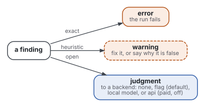
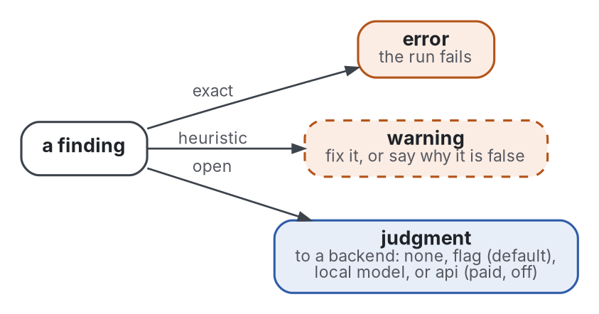

# Checks

The checks are the standard's oracle. Every principle names at least one check that tests it, and CI fails if one
names none.

Each check keeps one order: a program verifies what
a program can verify exactly, for free; a model works only where meaning is at stake; judgment takes what no model
should settle. Every check runs in polynomial time and space,
and none costs money: the one paid backend exists but is off.

## Tiers, and how often they run

| Tier | Needs | Runs | Finds |
|---|---|---|---|
| program | the Python standard library | every push | errors, warnings, questions |
| meaning | sentence embeddings (fastembed) | every push, model cached | questions |
| syntax | a parser (spaCy) | weekly, and on demand | warnings |
| judgment | a person, or a model if given | every push: listed | answers |

| Folder | Holds |
|---|---|
| [program/](program/) | the checks that need no model: paths, folders, links, size, outline, copies, terms, shapes, sentences, figures, stylesheet, citations, bibliography keys, history |
| [figures/](figures/) | the program-tier checks that read figures: drawn or typed, described, in step with their Graphviz source, readable on a phone |
| [meaning/](meaning/) | the checks that compare meaning: paraphrased copies, page mode, name against content, section cohesion |
| [syntax/](syntax/) | the checks that read a parse: [dependency length](../evidence/psycholinguistics/review.md), clause nesting, links between sentences |
| [framework/](framework/) | what every check is built on: the interface, the prose units, the judgment backends |
| [run.py](run.py) | the one entry point |
| [config.toml](config.toml) | every threshold, tagged PROVISIONAL where it is a convention, and the default tiers |
| [test_checks.py](test_checks.py) | the checks' own oracle: a planted violation per check |
| [test_framework.py](test_framework.py) | the runner, the config, the judgment step, and each way a run can fail |
| [test_tiers.py](test_tiers.py) | the meaning and syntax tiers' planted cases, skipped when their library is missing |
| [test_properties.py](test_properties.py) | properties every input must keep, tried on generated inputs from a seeded source |

What a check's findings can be trusted for, and what it costs, is said once, in its docstring. Each tier's README shows
it in the Guarantee column, and a test fails when a check does not say. Which principle each check serves is said once, on the principle's **Check:** line; `principle-coverage` holds every
principle to naming at least one registered check.

## Kinds of finding



<details>
<summary>Graphviz source</summary>



</details>

| Backend | What happens | Cost |
|---|---|---|
| `none` | questions dropped | free |
| `flag` (default) | questions written to `checks/out/needs-judgment.md` for the person or agent already at work | free |
| `local` | each question sent to a model on this machine through an OpenAI-compatible endpoint, set only by `READER_ERGONOMICS_LOCAL_URL` and `READER_ERGONOMICS_LOCAL_MODEL` | free, local |
| `api` | the same protocol to a paid provider (`READER_ERGONOMICS_API_URL`, `_KEY`, `_MODEL`); refuses to run unless `[judgment.api] enabled = true` | paid, off |

A model's answer is recorded as advice next to its question; it never fails the run. An answer that settles a question
goes in `checks/judgments.toml`, committed with the repository, with the fingerprint of the file it concerns: the
question stays answered until that file changes. Open questions are also written as entries to fill in, in `checks/out/judgments-to-answer.toml`. An answer quotes what
its reason rests on, and `judgment-quotes` checks that each quote is in the answered file: a reason copied from another
file's answer then fails.

## Use

```sh
python3 checks/run.py .                    # tiers from config
python3 checks/run.py . --tiers program    # no model at all
python3 checks/run.py path/to/repo         # another; its config wins
python3 checks/run.py . --online --only references
python3 -m unittest discover -s checks     # test the checks
pip install -r checks/meaning/requirements.txt   # the meaning tier
pip install -r checks/syntax/requirements.txt    # the syntax tier
```

A tier whose library is missing is skipped with a notice, never failed. `.github/workflows/checks.yml` runs the program
and meaning tiers on every push and pull request. It runs the syntax tier and the online references once a week.

## What other tools already check

The tools were searched on 2026-10-28, when 31 checks existed:

- **no counterpart**, for 11: none of the tools found checks overview first, terms defined across files, a missing
  figure, document mode, paraphrase, a name against its content, or a stylesheet's measure;
- **a partial counterpart**, a tool that checks a related but different thing, for 13;
- **a tool that does the same job**, for 7.

Of the checks added since the search, `bibliography-keys` was compared and has a partial counterpart, and the others
were not compared: 32 of the <!-- count:checks -->45<!-- /count --> checks registered today were compared. The table
below names, for each check compared, the closest tool and how it differs.

The program-tier checks stay on the standard library, so one
command runs them with nothing to install; a repository that already uses one of these tools can keep it.

| Check | Tool that covers it | How it differs |
|---|---|---|
| `links`, `references` | [lychee](https://github.com/lycheeverse/lychee) | also web links and fragments; no check of a DOI or arXiv form |
| `shape-conformance`, `outline-depth` | [markdownlint](https://github.com/DavidAnson/markdownlint) MD043, [mdschema](https://github.com/jackchuka/mdschema) | required headings in order; mdschema also sets a maximum heading depth |
| `long-sentences`, `paragraph-length` | [Vale](https://github.com/errata-ai/vale) | a rule from a style package or a custom one, not a statement count |
| `duplication` | [jscpd](https://github.com/kucherenko/jscpd) | copies of tokens, not of normalised prose |
| `sufficient-contrast` | [axe-core](https://github.com/dequelabs/axe-core) | measures the rendered page (see below) |
| `tree-shape`, for cycles | [import-linter](https://import-linter.readthedocs.io/en/stable/), for Python | cycles and layers per module; none of the tools searched counts the entries of a folder |
| `portable-paths` | [pre-commit-hooks](https://github.com/pre-commit/pre-commit-hooks) | case conflicts, illegal Windows names and symlinks, as separate hooks |
| `bibliography-keys` | [bibtex-tidy](https://github.com/FlamingTempura/bibtex-tidy) `--duplicates` | one BibTeX file, by DOI, key, abstract, or author and title; not across repositories |
| `co-change` | [code-maat](https://github.com/adamtornhill/code-maat) | coupling per file from the history, not per folder |

Partial matches not in the table: ESLint's max-lines (physical lines, not statements), ls-lint (names, not content),
markdownlint MD045 (alt text only), Vale's conditional rule (acronyms only) and eslint-plugin-unicorn's expiring-todo
(a date written in the comment).

## What is not checked here

The rendered page: contrast and measure are checked on the stylesheet's declared values, not on the pixels. A browser
accessibility checker measures the rendered page exactly.

## What passes here without being exercised

Some checks pass on this repository without being exercised: what they read does not exist here, or they are
switched off. A clean run is no proof that they work; their tests in [test_checks.py](test_checks.py) are.

| Check | Why it finds nothing here | Where it bites |
|---|---|---|
| `standard-pin`, `standard-links` | no workflow checks out the standard, since this is the standard | in each extension |
| `bibliography-keys`, against the family | `family = []`: this standard reads no extension ([decision 0003](../decisions/0003-one-key-one-work-across-the-family.md)); a key held twice in one file is still checked | in each extension |
| `provisional-tags` | a tag becomes a question after 90 days, and the history began on 2026-10-28 | from late January 2027 |
| `references`, online | resolves links only with `--online` | in the weekly CI run |
| `decision-records`, its cost question | `ask_costs = false` in config | when set to true |
