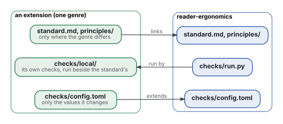
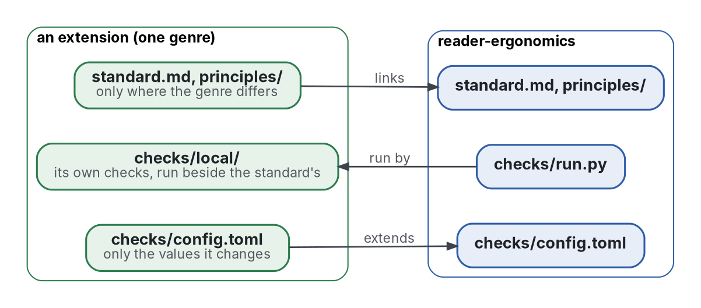

# Extending this standard

An **extension** is a repository that applies this standard to one genre (research papers, talks, writing about
software) and adds only what that genre changes. Six exist:

- [reader-ergonomics-academic](https://github.com/Tewf/reader-ergonomics-academic): reports, papers, mathematical
  articles and proofs;
- [reader-ergonomics-presentations](https://github.com/Tewf/reader-ergonomics-presentations): talks;
- [reader-ergonomics-software-design](https://github.com/Tewf/reader-ergonomics-software-design): writing about software;
- [reader-ergonomics-topic](https://github.com/Tewf/reader-ergonomics-topic): documentation as a tree of typed topics;
- [reader-ergonomics-learning](https://github.com/Tewf/reader-ergonomics-learning): material meant to be learned;
- [reader-ergonomics-blueprint](https://github.com/Tewf/reader-ergonomics-blueprint): reasoning written as a tree of
  topics, each checked, Lean first; it builds on the topic extension.

This page is the contract between the standard and its extensions. It says how an extension is laid out, and which
parts of this repository it can rely on when this one changes.



<details>
<summary>Graphviz source</summary>



</details>

The arrows point one way. This standard depends on no extension: it never reads, runs or copies what an extension
holds. It may list them, as this page does, since a link is a reference, not a dependency
([decision 0001](decisions/0001-extensions-depend-one-way.md)).

## The layout an extension mirrors

People read an extension on its site, and language models read it through `llms.txt` and `AGENTS.md`, as they
read this repository. So an extension keeps the same parts, each with the same role:

| Part | Role in an extension |
|---|---|
| `standard.md` | the genre's card: read this standard first, then the genre's principles; its table is generated |
| `principles/<group>/` | one file per principle the genre adds or changes, in the format below |
| `shapes/` | templates of the genre's documents |
| `reader-styles/` | only readers particular to the genre |
| `evidence/` | one review per topic, with its bibliography |
| `checks/` | the config that extends this one, and `local/` for the genre's own checks |
| `AGENTS.md`, `llms.txt` | how to change it, and its index for models |
| `README.md`, `README.fr.md` | the front page, in English and in French |

A principle this standard already holds is linked, never copied.

## The interface

These parts are stable within a major version. An extension relies on them and on nothing else in this repository.

| Part | Contract |
|---|---|
| Principle file | `principles/<group>/<name>.md`; a first line `# Title`; the lines `**Claim:**`, `**Grade:**`, `**Evidence:**`, `**Check:**` (check names in backticks) and `**Reader styles:**` |
| Group | `principles/<group>/README.md`, whose first line is the group's heading |
| Card | `standard.md` holds `<!-- principles:start -->` and `<!-- principles:end -->`; the table between them is built from the principle files |
| Bibliography | `evidence/bibliography.md`, a table `Key | Citation | Link`; a key is `Surname Year`, with one letter after the year at most, or for an organisation one title word instead (`Microsoft 2026 icons`), and names one work across the repositories listed in `[bibliography_keys] family` (`bibliography-keys`) |
| Command | `python3 checks/run.py ROOT [--tiers ...] [--only ...] [--online] [--judge ...]`; it exits with 1 when any exact check fails, and with 2 when it could check nothing: ROOT is not a folder, the config is missing or invalid, or no file is in scope |
| Config | `checks/config.toml` with `extends = "reader-ergonomics"` is merged onto this standard's config, table by table, and the extension's value wins; any other `extends` stops the run |
| Local checks | each module in `checks/local/` defines `NAME` and `check(root, config)`, which returns `Finding` objects from `framework.check_api`; `TIER` is optional |
| Indexes | `python3 checks/program/standard_card.py ROOT --write` builds the card's table and `llms.txt`, taking the site, title and description from the extension's `_quarto.yml` and the groups from `[standard_card] facets` |
| Judgment answers | `checks/judgments.toml`, optional: `[[answer]]` entries with `check`, `path`, `question`, `file` (the fingerprint of the file when answered) and `answer`; an edit to the file reopens its questions, and each answer quotes its file in backticks or double quotes (`judgment-quotes`) |
| Site | `site.css` at the root, which an extension's site may load |

A local check counts for `principle-coverage`, so an extension's principle can name a check of its own.

A bibliography key names one work across the family ([decision 0003](decisions/0003-one-key-one-work-across-the-family.md)):

- when two works share a key, this standard's key wins;
- between extensions, the older use wins: the first commit on the default branch that adds the row;
- the work that loses the key takes the next letter free in the family, or, for an organisation, a title word
  ([decision 0004](decisions/0004-an-organisation-key-may-carry-a-title-word.md));
- the year in a key is the year of the version read, and an undated page takes the year it was read.

A stylesheet listed in config that does not exist is a warning, so an extension that loads this standard's `site.css`
rather than one of its own sets `stylesheets = []` under `[readable_measure]` and `[sufficient_contrast]`.

## Versions

Releases are tagged `vMAJOR.MINOR.PATCH`. A change that breaks any part of the interface raises the major number.

An extension's CI checks out a release by its commit. It never checks out the tag or the latest commit: a tag can be
moved, and a commit cannot. The tag is named in a comment beside the commit:

```yaml
ref: <the release's commit, all 40 characters>   # v1.0.0
```

The extension moves to a new release deliberately, by changing that line. The same bump moves every other copy of
the release:

- every job that checks out the standard names that commit: the checks, and the site that loads `site.css`
  (`standard-pin`);
- every link from the text into the standard's repository names that commit, or the tag in that line's comment
  (`standard-links`);
- the newest pin line of the extension's `CHANGELOG.md` names it too (`changelog-pin`).

A move to a new release is not a decision record, since it had no alternative: it is a line in `CHANGELOG.md` at the
extension's root, the form of Keep a Changelog, newest first. The line says the new release and its commit, the old
one, and what the new one carries. Its heading is the extension's version and date; an extension with no versions
uses the date alone:

```markdown
## 2026-10-29

### Changed

- Pinned reader-ergonomics v1.16.1 (`397a555`), from v1.13.0 (`7a76cc6`): each evidence review opens with what it
  holds, and a claim is graded clause by clause.
```

What each release carries is in the standard's [CHANGELOG](CHANGELOG.md).

To run a release's checks on a local copy, extract it inside the extension, in the `checks/out/` that git ignores,
rather than beside the repositories, where each release would leave a folder behind:

```sh
rm -rf checks/out/standard && mkdir -p checks/out/standard
git -C ../reader-ergonomics archive <the release's commit> | tar -x -C checks/out/standard
python3 checks/out/standard/checks/run.py .
```

The checks skip what git ignores, so the extracted standard is not checked as part of the extension.

## Trust

`run.py` runs the code in the checked repository's `checks/local/`. Run it only on repositories you trust; in CI, an
extension runs its own code on its own runner.
